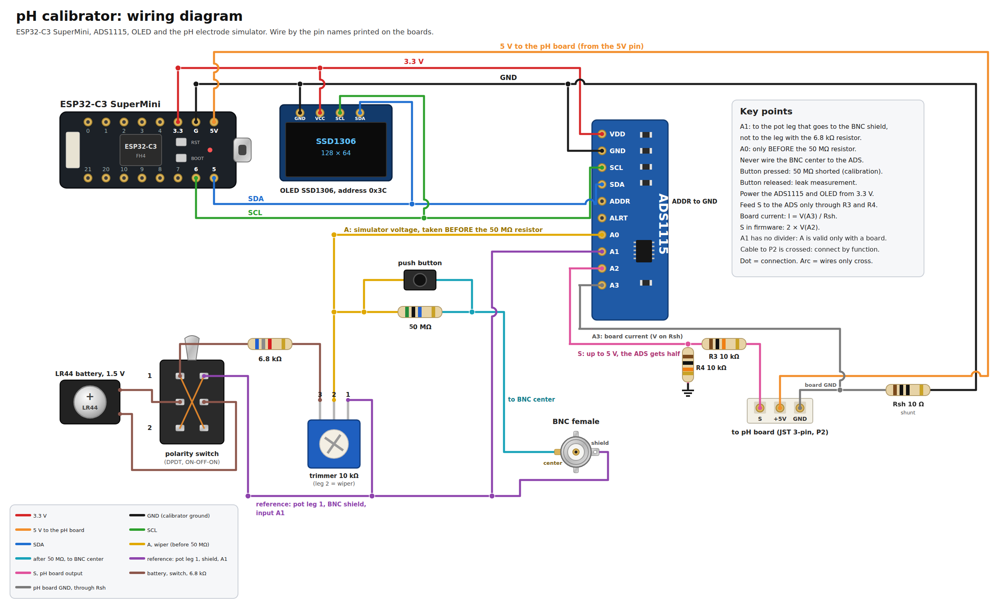

# Імітатор pH-електрода і тестер витоку

*[English](README.md)*

Стендовий прилад для плат pH-електрода (електрометричних вхідних каскадів). Імітатор на
батарейці подає на плату відому напругу E через великий послідовний резистор - так, як це
робить скляний електрод. ESP32-C3 з ADS1115 міряє E і вихід плати S, за двома точками
калібрування знаходить підсилення і нуль плати, а далі показує **струм витоку входу** -
ту несправність, через яку плата не помічає цілком справного електрода, хоча на
низькоомне тестове джерело ще реагує. Покази - на OLED 128x64 і на веб-сторінці (EN / UA)
з живими графіками.

Навіщо він з'явився: [плата, яка не бачила справного електрода](docs/case-study-leaky-board.md)
(англійською). Як рахується витік: [docs/leak-measurement.md](docs/leak-measurement.md).



Та сама схема як принципова: [docs/schematic.pdf](docs/schematic.pdf) (проєкт KiCad 10 у
[hardware/](hardware/)).

## Що показує

- **A**: напругу імітатора в мВ і pH, який їй відповідає (`pH = 7 - A/59.16`, 25 °C).
- **S**: вихід плати у В і pH, який плата показує після калібрування.
- **Струм витоку** в нА, у скільки разів він перевищує вашу норму, і графік у часі.
- **Підсилення і нуль** плати (пряма E → S за двома точками), **шум** S і **струм
  живлення** плати.
- **Рівновагу електрода**: як швидко справжній електрод встановлюється після занурення
  (час до рівноваги, t63, дрейф).
- Історію в браузері (1 точка/с, ~14 год) із завантаженням у CSV.

## Деталі

| | |
|---|---|
| Контролер | ESP32-C3 SuperMini |
| АЦП | модуль ADS1115 (I2C 0x48), живлення 3.3 В |
| Екран | OLED SSD1306 128x64, I2C 0x3C |
| Імітатор | елемент LR44, перемикач DPDT ON-OFF-ON (полярність), 6.8 кОм, підстроєчник 10 кОм |
| Послідовний резистор | 50 МОм (п'ять SMD-резисторів по 10 МОм послідовно), для калібрування його закорочує кнопка |
| Роз'єми плати | BNC (гніздо); JST 3-pin (S, +5 В, GND) |
| Дільник S | R3 = R4 = 10 кОм (на ADS іде S/2) |
| Шунт струму | Rsh (R5) = 10 Ом у землі плати |

Паяйте за назвами виводів, надрукованими на модулях. Центр BNC (високоомний вузол) до ADS
не підключати ніколи - вхід ADS сам став би витоком.

JST з'єднуйте з платою за призначенням - +5 В до її живлення, GND до її землі, S до її
виходу - і перед увімкненням перевірте порядок виводів з обох боків.
Тут у JST посередині +5 В, а в плати pH з цього проєкту посередині земля (P2: 1 VCC,
2 com, 3 S), тож кабель між ними перехрещений.

## Збірка і прошивка

[PlatformIO](https://platformio.org/) Core 6.2.0 або новіший (цього вимагає pioarduino).
У теці з `platformio.ini`:

```bash
pio run -t upload -t monitor
```

Усі версії закріплені в [`platformio.ini`](platformio.ini): платформа (pioarduino
55.03.312-1 = Arduino core 3.3.12, ESP-IDF 5.5.5, GCC 14.2) і кожна бібліотека (Adafruit
ADS1X15 2.6.2, Adafruit BusIO 1.17.4, U8g2 2.36.18, AsyncTCP 3.5.0, ESPAsyncWebServer
3.12.1). Перша збірка їх завантажить. Не послаблюйте ці версії, інакше за рік проєкт
перестане збиратися.

### Порт

У `platformio.ini` порт не вказано: коли підключена одна плата, PlatformIO знаходить її
сам. Якщо плат кілька (наприклад, ще одна ESP на тому самому USB-хабі), треба сказати,
котру прошивати. Одноразово:

```bash
pio run -t upload --upload-port /dev/cu.usbmodem1101
```

або назавжди - у `platformio_local.ini` поруч із `platformio.ini` (git його не бачить, а
підхоплює рядок `extra_configs`):

```ini
[env:esp32-c3-devkitm-1]
upload_port  = /dev/cu.usbmodem1101
monitor_port = /dev/cu.usbmodem1101
```

Назву порту покаже `pio device list`. ESP32-C3 SuperMini працює через власний USB, тому
на macOS це `/dev/cu.usbmodem…`, на Linux `/dev/ttyACM0`, на Windows `COMx`.

## Wi-Fi

Мережа в прошивку не вшита. Під час першого старту під'єднатися нікуди, тож калібратор
піднімає власну точку доступу:

| | |
|---|---|
| Мережа | `pH-Calibrator` |
| Пароль | `calib1234` |
| Сторінка | `http://192.168.4.1/` (телефон зазвичай відкриває її сам) |

Відкрийте блок **Wi-Fi** унизу сторінки, натисніть **Знайти мережі**, оберіть свою,
введіть пароль і натисніть **Зберегти і перезапустити**. Калібратор під'єднається, і далі
відповідатиме за адресою `http://calibrator.local/` (або за IP, який кілька секунд після
старту показує OLED). Працюють лише мережі 2.4 ГГц.

Якщо збережена мережа недоступна, за 20 с калібратор повертається до тієї ж точки
доступу. Кнопка **Забути мережу** переводить його туди одразу. Якщо мережа зникла вже
після під'єднання, калібратор повертається в неї сам.

Для власних збірок мережу за замовчуванням можна покласти в `src/wifi_secret.h` (git його
не бачить). Вона діє лише доти, доки на сторінці не збережено іншу:

```c
#pragma once
#define WIFI_SSID "my-network"
#define WIFI_PASS "my-password"
```

Сторінка без пароля: користуйтеся нею в мережі, якій довіряєте.

## Знак каналу A

Знак каналу A (напруга імітатора, ADS1115 AIN0-AIN1) залежить від того, як підключені
два дроти. Перевірте його один раз після збирання:

1. Натисніть і тримайте кнопку (послідовний резистор закорочено).
2. Увімкніть тестер на DC мВ і прикладіть до BNC: **червоний щуп - на центр, чорний - на
   екран**.
3. Порівняйте знак тестера зі знаком **A** на OLED або на сторінці.

Знаки однакові - нічого робити не треба. Знаки протилежні - змініть у
[`src/main.cpp`](src/main.cpp) `A_SIGN` (`-1.0f` на `1.0f` або навпаки) і прошийте
знову, або поміняйте місцями дроти AIN0 і AIN1. За величиною A має збігатися з тестером
до кількох десятих мВ. Сталий зсув прибирає кнопка **Автонуль A** на сторінці
(підстроєчник при цьому - в нульовому положенні).

Знак важливий: pH на сторінці дорівнює `7 - A/59.16` (плюсові мВ = кисле), а витік
рахується з різниці між A і входом плати. З неправильним знаком і pH буде хибний, і цифра
витоку втратить сенс.

## Як перевірити плату

1. Кнопка **натиснута**: виставте підстроєчником якусь E, **Зняти точку 1**. Виставте
   помітно іншу E (перекиньте перемикач полярності), **Зняти точку 2**. Пряма **готова**.
2. Впишіть свій послідовний резистор у **Резистор R, МОм** (типово 50).
3. Кнопка **відпущена**: читайте витік. Дивіться графік, поки вимита плата сохне.

Подробиці, формули і пастки: [docs/leak-measurement.md](docs/leak-measurement.md).

## Serial

USB CDC, 115200 бод. Рядок CSV `millis,A_mV,S_V,pH` на кожен цикл виміру (близько
0.4 с: кожен канал усереднює 25 вибірок). Команди:

| | |
|---|---|
| `z` | автонуль A |
| `Z` | скинути автонуль |
| `r` | показати автонуль |
| `v` | перевірка монтажу: кожен вхід ADS AIN0..AIN3 відносно GND, у вольтах |

## Обмеження

- pH для A рахується за ідеальним Нернстом при 25 °C, без температурної компенсації -
  це імітатор, а не pH-метр.
- Роздільність витоку визначають R і шум, а не арифметика. З 50 МОм один відлік АЦП -
  менше 1 пА; наводка 50 Гц і дрейф на високоомному вузлі більші. Більший R (1 ГОм)
  вимагає тримати вузол у повітрі або на тефлоні, у металевій коробці.
- Плата, яку перевіряємо, живиться від USB 5 В. Якщо її нуль залежить від живлення, а
  напруга USB зміниться між калібруванням і виміром, з'явиться невеликий хибний витік.
- Каналу A потрібна плата. Опора імітатора - нога підстроєчника, екран BNC і A1 - не має
  власного дільника. З приєднаною платою покази правильні; без неї A1 пливе і A нічого не
  означає. Дільник 10 кОм / 10 кОм від 3.3 В до GND зі 100 нФ, середньою точкою на A1,
  зробив би A самостійним; прилад автора працює без нього.

## Ліцензія

Відкрите залізо, у трьох частинах (див. [LICENSE](LICENSE)):

- залізо (схема підключення, схеми, плати): [CERN-OHL-S v2](LICENSES/CERN-OHL-S-2.0.txt);
- прошивка і скрипти: [GPL-3.0-or-later](LICENSES/GPL-3.0-or-later.txt);
- документація і зображення: [CC BY-SA 4.0](LICENSES/CC-BY-SA-4.0.txt).

Прилад можна збирати, змінювати, поширювати і продавати. Змінену версію, яку ви поширюєте,
треба лишити під тими самими ліцензіями і відкрити її вихідні файли.
